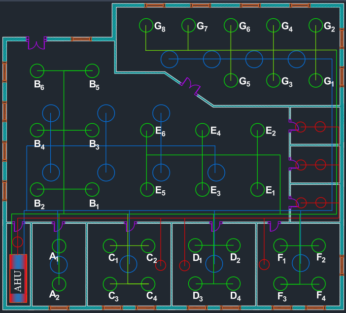
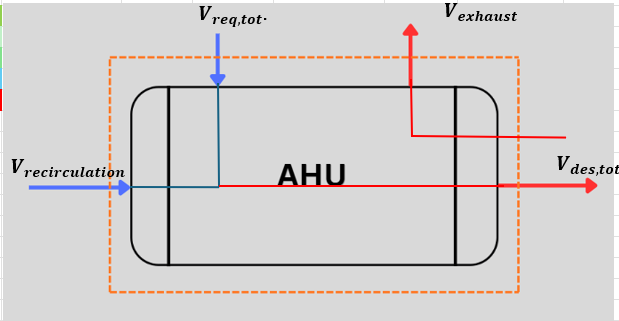
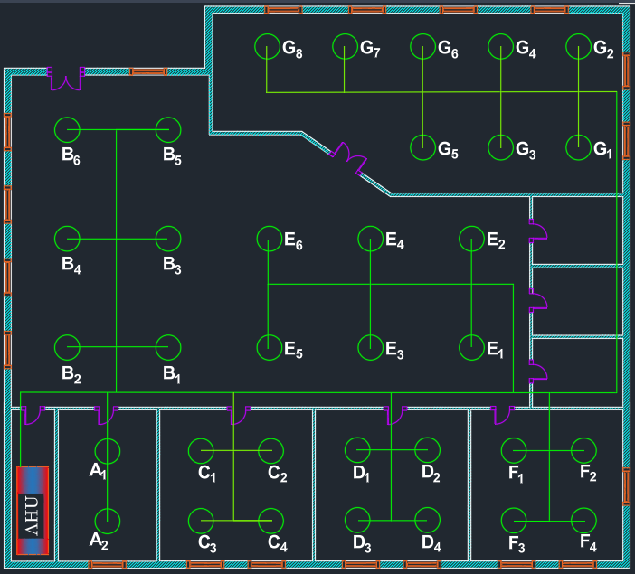
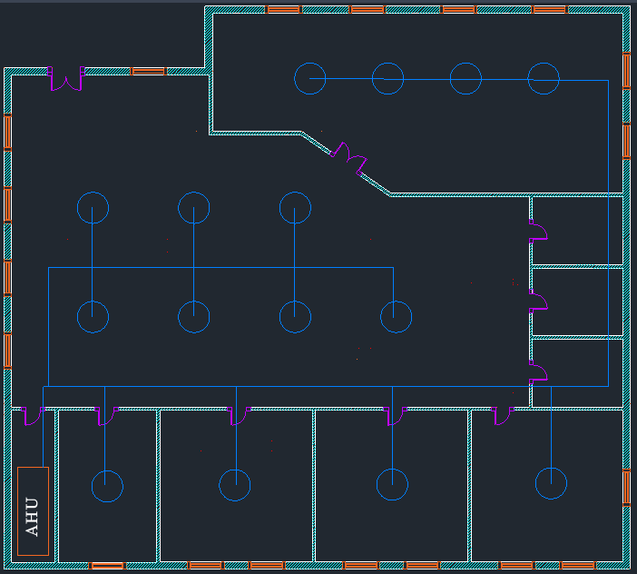
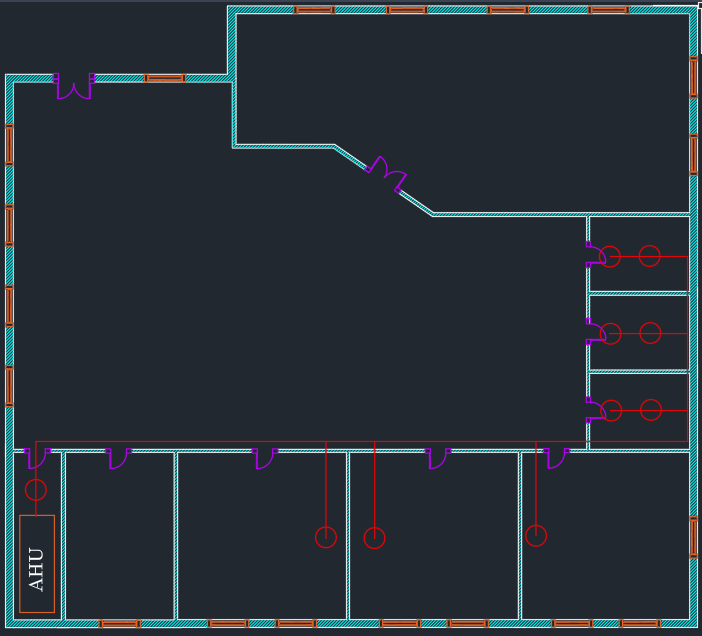
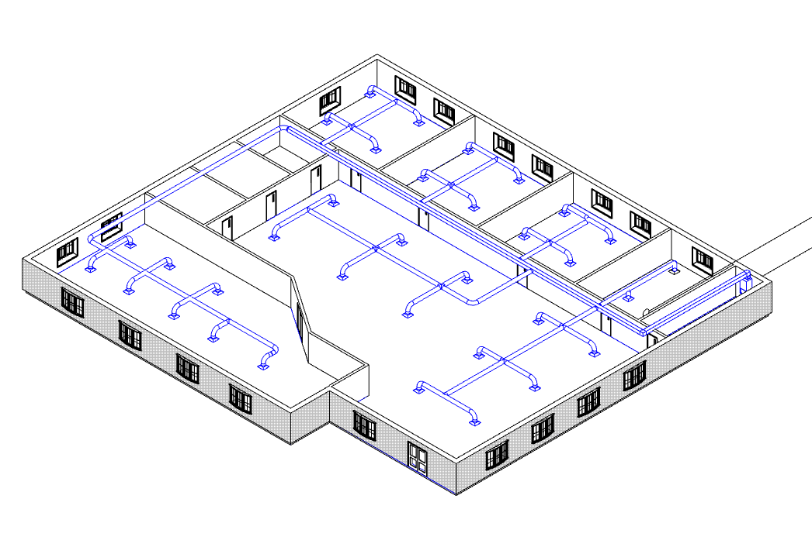

# Design and Sizing of a Full-Air HVAC System for an Office Building

Complete design of a centralized **full-air (constant air volume) ventilation and air-conditioning system**
for a 1,325 m² single-storey office building in **Copenhagen, Denmark**: airflow rates per room, fresh-air
and recirculation strategy, supply/return/exhaust vent selection, duct layout and sizing, pressure-drop
calculation and air handling unit (AHU) fan specification, with a 3D Revit model of the supply network.

Group project for **Heating, Ventilation and Air Conditioning Systems** (INQ0091662), M.Sc. Energy Engineering,
University of Padova, May 2026. Authors: Kaleb Kassa Lafebo and Abenezer Leulseged Wolde.
Instructors: Prof. Michele De Carli, Eng. Marco Marigo.

📄 **Full report:** [`report/Full-Air-HVAC-Design-Report.pdf`](report/Full-Air-HVAC-Design-Report.pdf)



## Key results

| Quantity | Result |
|---|---|
| Building | 1,324.67 m² net floor area, 2.7 m ceiling, 10 zones (open-plan and general workspace, 4 offices, 3 bathrooms, storage) |
| Peak loads | **54.57 kW** heating · **31.60 kW** cooling |
| Indoor air quality | EN 16798-1 **Category II**, low-polluting building (4 L/s per person + 0.7 L/(s·m²)) |
| Design supply airflow | **10,150 m³/h** |
| Fresh air / recirculated air | **3,920 m³/h** (mixing ratio 0.386) / **6,230 m³/h** (≈ 61 % recirculation) |
| Exhaust | 3,920 m³/h from bathrooms, storage and offices, balancing the fresh-air intake |
| Supply diffusers | 34 ceiling diffusers, Ø202–302 mm, about 5 m/s blow-out, 13–24 Pa each |
| Ducts | Circular aluminium; main trunk Ø630 → 500 mm (9.0 → 3.1 m/s); friction ≤ 0.98 Pa/m |
| Critical (index) run | Branch G, last diffuser G8: **120.8 Pa** |
| Total network static pressure | **455 Pa** (main duct 334 Pa + index branch 121 Pa) → AHU fan sizing point |

## Design steps

### 1. Airflow rates per room
For every zone the design flow is the largest of three requirements: fresh air for occupants and building
emissions (EN 16798-1), the airflow needed to cover the **heating** load with supply at 38 °C (ΔT = 17 K), and
the airflow needed to cover the **cooling** load with supply at 15.5 °C (ΔT = 10 K):

V<sub>design</sub> = max(V<sub>req</sub>, V<sub>load,H</sub>, V<sub>load,C</sub>), with V<sub>load</sub> = q / (ρ c<sub>p</sub> |t<sub>S</sub> − t<sub>A</sub>|)

The open-plan workspace is the critical zone: its cooling load sets 3,822 m³/h and it has the highest
fresh-air share (0.386). Applying that ratio to the whole constant-volume system guarantees Category II air
quality in every room while recirculating the rest.



### 2. Vents
Supply diffusers were selected on the manufacturer's nomogram for the 2.7 m ceiling: neck diameter, effective
velocity, throw L<sub>0.5</sub>, minimum spacing, pressure drop and sound power, iterating the number of vents until
throw, spacing and noise were all acceptable (for example Office 1: 2 × Ø252 mm; Office 4: 4 × Ø202 mm;
open-plan workspace: 12 × Ø302 mm). Bathrooms and storage are kept under negative pressure with dedicated
exhaust and are excluded from recirculation.

| Supply diffusers | Recirculation | Exhaust |
|---|---|---|
|  |  |  |

### 3. Ducts
Tree-branch layout from the AHU along the central corridor, sized with the **velocity reduction method**
(main ≤ 8–9 m/s, secondary ≤ 6 m/s, final runouts 3–5 m/s) and rounded to standard circular diameters.
Secondary ducts and runouts were then up-sized wherever rounding would have made the air speed up downstream,
so velocity always decreases towards the diffusers.

### 4. Pressure drop and AHU
Continuous losses from the UNI 10381-2 friction charts (Darcy–Weisbach) and localized losses from fitting
coefficients (ΔP = ξ ρv²/2), computed per segment with the solvers in `calculations/`. The index run is the last
diffuser of branch G (120.8 Pa); with the 334.4 Pa of the main duct, the fan must deliver **10,150 m³/h at
about 455 Pa** of external static pressure, plus the AHU's internal coil and filter losses.

### 5. 3D model
A Revit model of the supply network shows the routing from the plant room along the corridor into the offices
and workspaces (supply only; duct sizes are indicative).



## Repository structure

```
├── report/          final report (PDF)
├── calculations/
│   ├── airflow-vent-and-duct-sizing.xlsx           airflows, mixing ratio, vents, duct sizing
│   ├── main-duct-pressure-drop-solver.xlsm         main trunk pressure drop (macro-enabled)
│   └── secondary-duct-pressure-drop-solver.xlsm    secondary branches pressure drop (macro-enabled)
├── drawings/        AutoCAD drawings: HVAC layout and floor plan
├── models/          Revit template of the supply network (.rte)
└── figures/         figures from the report
```

Open the `.xlsm` solvers in Excel with macros enabled. The drawings need AutoCAD (or a free DWG viewer);
the model needs Autodesk Revit.

## Standards and references

- EN 16798-1:2019, ventilation for buildings: indoor environmental input parameters
- ASHRAE Handbook, Fundamentals, Ch. 21: Duct Design
- UNI 10381-2, duct pressure-loss nomograms
- F. C. McQuiston, J. D. Parker, J. D. Spitler, *Heating, Ventilating, and Air Conditioning: Analysis and Design*, 6th ed.

## Authors

**Kaleb Kassa Lafebo** and **Abenezer Leulseged Wolde**, M.Sc. Energy Engineering, University of Padova.
[LinkedIn](https://www.linkedin.com/in/kaleb-kassa) · [GitHub](https://github.com/Kaleb-kass)
